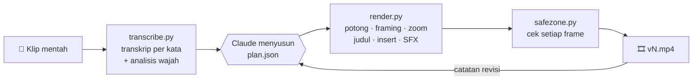

<div align="center">

# 🎬 videoskills

**Dari klip talking-head mentah ke reel 9:16 siap upload, dengan satu perintah di Claude Code.**

Taruh klip mentahmu, jalankan `/video-edit`, review hasilnya di HP, lalu kasih catatan revisi.
Tanpa membuka editor video.

[](LICENSE)
[](https://claude.com/claude-code)
[](https://www.python.org/)
[](https://ffmpeg.org/)
[](#-prasyarat)

[Fitur](#-fitur) · [Cara kerja](#-cara-kerja) · [Mulai cepat](#-mulai-cepat) · [Konfigurasi](#-konfigurasi-planjson) · [Batasan](#-batasan)

</div>

---

## ✨ Kenapa skill ini

| Edit manual | Dengan `/video-edit` |
|---|---|
| Scrub timeline untuk mencari take yang paling bersih | Take terbaik dipilih dari transkrip semua klip |
| Memotong jeda dan salah ucap satu per satu | Jeda dipotong otomatis berdasarkan level audio |
| Membuat caption, judul, dan efek sendiri | Caption per kata, kata di belakang kepala, dan insert animasi dibuat otomatis |
| Mengecek manual apakah teks tertutup UI Instagram | Safe zone Reels dicek frame per frame |
| Mengulang dari awal setiap ada revisi | Kasih catatan, lalu render ulang dari cache dalam hitungan detik |

## 🧩 Fitur

<table>
<tr>
<td width="50%" valign="top">

### ✂️ Editorial
- **Pemilihan take**: kalimat yang diulang memakai take lengkap terakhir yang bersih
- **Pemotongan dead air** berdasarkan energi audio, bukan hanya timestamp Whisper
- **Transkrip per kata** dengan faster-whisper, plus penanda kata yang mungkin salah dengar
- **Koreksi caption**, misalnya `cloud` menjadi `Claude`, tanpa mengubah audio

</td>
<td width="50%" valign="top">

### 🎥 Visual
- **Framing 9:16 mengikuti wajah**, termasuk untuk klip landscape
- **Punch-in zoom** otomatis di setiap jump cut (1,3x sampai 1,9x)
- **Kata di belakang kepala**: orang dipisahkan dari background, teks diselipkan di antaranya
- **Tiga look**: `bold`, `clean`, dan `editorial`, bisa diganti per kalimat

</td>
</tr>
<tr>
<td width="50%" valign="top">

### 🧱 Insert animasi
- **Kartu screenshot** dengan animasi pop
- **Scroll file** untuk dokumen atau halaman panjang
- **Kartu Follow** untuk CTA, tombolnya berubah menjadi "Following"
- **B-roll** layar penuh, caption tetap tampil di atas
- **Insert custom** dibuat paralel oleh sub-agent

</td>
<td width="50%" valign="top">

### 🔊 Audio & QA
- **Efek suara sintetis** (whoosh, pop, tick, ding), tanpa file sampel dan bebas lisensi
- Efek selalu **lebih pelan dari suara** (default -12 dB relatif)
- **Normalisasi loudness** ke -14 LUFS
- **Cek safe zone per frame**: header, area username/caption, kolom tombol, dan wajah

</td>
</tr>
</table>

## 🔁 Cara kerja



1. **Transkrip.** Setiap klip ditranskrip per kata dan dianalisis posisi wajahnya. Hasilnya di-cache, jadi klip yang tidak berubah tidak diproses ulang.
2. **Keputusan editorial.** Claude membaca transkrip, memilih take, lalu menulis `plan.json`: bagian yang dipakai, judul, insert, dan look.
3. **Render.** Segmen dipotong dan di-crop paralel, lalu digabung bersama judul, insert, caption, dan efek suara dalam satu pass ffmpeg.
4. **QA.** Layer teks dirender terpisah dan dicek frame per frame terhadap area UI Reels dan posisi wajah.
5. **Revisi.** Catatan seperti "potong bagian ini" atau "caption kurang ke atas" diterjemahkan ke `plan.json`. Versi lama tidak pernah ditimpa.

## 🚀 Mulai cepat

### 📋 Prasyarat

- [Claude Code](https://claude.com/claude-code)
- Python 3.9 atau lebih baru
- Klip talking-head (paling baik vertikal 9:16)

ffmpeg **tidak perlu** dipasang di sistem. Setup memasang ffmpeg di dalam virtualenv skill.

### 📦 Instalasi

```bash
git clone https://github.com/rochiyat/videoskills.git
cd videoskills
python .claude/skills/video-edit/scripts/setup.py
```

Setup akan:
- membuat virtualenv di `.claude/skills/video-edit/.venv`
- memasang faster-whisper, PyAV, MediaPipe, Pillow, dan ffmpeg
- mengunduh model wajah dan segmentasi MediaPipe (sekitar 16 MB)
- menjalankan `doctor.py` untuk memastikan semuanya siap

Model Whisper diunduh otomatis saat transkripsi pertama.

<details>
<summary><b>Pakai di semua proyek (instalasi global)</b></summary>

Secara default, `/video-edit` hanya tersedia saat Claude Code dibuka di folder repo ini. Supaya tersedia di semua proyek, salin folder skill ke direktori skill pengguna lalu jalankan setup di sana.

**macOS / Linux**
```bash
cp -r .claude/skills/video-edit ~/.claude/skills/
python ~/.claude/skills/video-edit/scripts/setup.py
```

**Windows (PowerShell)**
```powershell
Copy-Item -Recurse .claude\skills\video-edit $HOME\.claude\skills\
python $HOME\.claude\skills\video-edit\scripts\setup.py
```

</details>

### ▶️ Pemakaian

Buka Claude Code, lalu jalankan:

```
/video-edit D:\rekaman\reel-minggu-ini
```

Claude akan mentranskrip, menyusun plan, mengecek naskah, merender, dan memeriksa safe zone. Hasilnya ada di `<folder>/_edit/output/v1.mp4`. Setelah itu kasih catatan biasa, misalnya:

> potong kalimat "oke ulang ya", judulnya ganti jadi "3 TIPS", pakai look editorial

Hasil revisinya disimpan sebagai `v2.mp4`.

## ⚙️ Konfigurasi `plan.json`

Biasanya Claude yang menulis file ini. Kamu tetap bisa mengeditnya langsung, dan hanya `keep` yang wajib diisi.

```jsonc
{
  "look": "bold",                                    // bold | clean | editorial
  "keep": [
    { "clip": "c1", "from": 15, "to": 22 },          // index kata dari transcript.txt
    { "clip": "c1", "from": 35, "to": 46, "look": "editorial", "zoom": 1.6 }
  ],
  "titles":  [{ "text": "3 hal", "at": "c1:21" }],   // kata besar di belakang kepala
  "inserts": [
    { "type": "image", "src": "screenshot.png", "at": "c1:39", "until": "c1:46" },
    { "type": "cta", "name": "Nama Kamu", "handle": "@akun", "at": "c2:16", "dur": 3 }
  ],
  "replacements": { "cloud": "Claude" }
}
```

Referensi lengkap semua field ada di [`SKILL.md`](.claude/skills/video-edit/SKILL.md).

### 🎨 Look

| Look | Caption | Judul | Color grade |
|---|---|---|---|
| `bold` | Arial Black kapital, highlight kuning | Arial Black kapital | Kontras dan saturasi naik |
| `clean` | Arial bold di kotak gelap transparan | Arial Black | Netral |
| `editorial` | Georgia italic krem, highlight peach | Georgia italic | Hangat, saturasi lebih lembut |

## 📂 Struktur proyek

```
.claude/skills/video-edit/
├── SKILL.md            # alur kerja dan aturan editorial untuk Claude
├── requirements.txt
└── scripts/
    ├── setup.py        # virtualenv + dependensi + model
    ├── doctor.py       # cek kesiapan lingkungan
    ├── transcribe.py   # transkrip per kata + analisis wajah
    ├── render.py       # pipeline render utama
    ├── framing.py      # crop 9:16 dan punch-in zoom
    ├── titles.py       # kata di belakang kepala
    ├── inserts.py      # kartu, scroll, CTA, B-roll
    ├── styles.py       # preset look
    ├── sfx.py          # efek suara sintetis dan mixing
    ├── safezone.py     # cek safe zone per frame
    ├── vision.py       # deteksi wajah dan matte orang
    ├── snapshot.py     # ambil frame untuk review visual
    └── common.py
```

Semua hasil kerja disimpan di `<folder klip>/_edit/`. File klip asli hanya dibaca dan tidak pernah diubah.

## ⏱️ Performa

Diukur pada laptop Windows dengan GTX 1650 Ti (transkripsi di CPU), untuk reel 12 detik berisi semua fitur: judul, empat insert, dan efek suara.

| Tahap | Waktu |
|---|---|
| Transkripsi (model `small`, klip 23 detik) | sekitar 6 detik |
| Analisis wajah (klip 23 detik, 1440x2560) | sekitar 9 detik |
| Render pertama 1080x1920 | sekitar 59 detik |
| Render revisi (dari cache) | sekitar 34 detik |
| Render draft 540x960 | sekitar 25 detik |

## ⚠️ Batasan

- **Belum diuji dengan rekaman asli berbahasa Indonesia.** Pengujian sejauh ini memakai klip sintetis dan video stock dengan audio TTS bahasa Inggris. Kalau transkrip banyak salah dengar, pakai `--model medium`.
- **Kualitas matte** bergantung pada kontras orang dengan background. Rambut tipis di depan background ramai bisa terlihat kurang rapi.
- **Area UI Reels** adalah perkiraan tata letak aplikasi Instagram saat ini.
- **Kartu insert** muncul di sepertiga atas frame dan menutupi wajah selama tampil.
- **Font** memakai font sistem Windows dan macOS. Font lain bisa ditambahkan lewat `assets/fonts/`.
- **GPU** belum dipakai untuk transkripsi. faster-whisper butuh CUDA 12, jadi di driver lama transkripsi jalan di CPU.

## 🗺️ Roadmap

- [ ] Uji coba dengan rekaman asli (bahasa Indonesia, video HP, klip landscape)
- [ ] `/talking-head-reel-editor`: edit ulang video jadi dengan B-roll setiap 1 sampai 4 detik
- [ ] Posisi kartu insert yang bisa diatur
- [ ] Tes regresi otomatis
- [ ] Panduan instalasi lengkap berbahasa Indonesia

## 🙏 Dibangun dengan

- [faster-whisper](https://github.com/SYSTRAN/faster-whisper) (MIT) untuk transkripsi per kata
- [MediaPipe](https://github.com/google-ai-edge/mediapipe) (Apache 2.0) untuk deteksi wajah dan segmentasi orang
- [FFmpeg](https://ffmpeg.org/) melalui [imageio-ffmpeg](https://github.com/imageio/imageio-ffmpeg) untuk pemrosesan video
- [PyAV](https://github.com/PyAV-Org/PyAV), [OpenCV](https://opencv.org/), [Pillow](https://python-pillow.org/), dan [NumPy](https://numpy.org/)

Binary ffmpeg yang dipasang lewat pip berlisensi GPL dan diunduh oleh pengguna sendiri saat setup. Binary itu tidak disertakan di repo ini.

## 📄 Lisensi

[MIT](LICENSE) © 2026 Rochiyat
